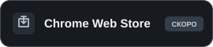
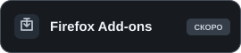

# Templar VPN для Chrome и Firefox

**Русский — основной** · [English](README.en.md)

[Сайт Templar VPN](https://templarvpn.com/) · [Telegram-бот](https://t.me/TemplarVPN_bot) · [Личный кабинет](https://cabinet.templarvpn.com/)

Открытые исходники браузерного расширения Templar VPN, версия **0.4.5**.
Расширение подключает поддерживаемый браузер через выбранную локацию вашей
подписки. Остальные приложения на устройстве продолжают работать со своим
обычным подключением. Интерфейс поддерживает русский и английский языки.

Сейчас доступны исходники и локальная сборка для разработки. Подписанных
магазинных релизов пока нет; загрузка в магазины и отправка на подпись остаются
на паузе. Не устанавливайте сборки из неизвестных источников.

## Установка из магазинов

Карточки расширения пока не опубликованы. Это кнопки-заглушки: они открывают
требования к публикации, а не установку. После выпуска здесь появятся прямые
ссылки на Templar VPN в магазинах.

Для выпуска нужны аккаунты разработчика с двухфакторной защитой, публичная
политика конфиденциальности, карточки и скриншоты, доступ для проверяющих,
финальные пакеты и проверка магазинами. **[Полный список подготовки и текущий
статус](release/PUBLISHING.md)**. Сборка из исходников описана в [VERIFYING.md](VERIFYING.md).

## Возможности

- Вход по ссылке подписки, email и паролю от личного кабинета или через Telegram.
- Выбор выданных подписке TCP/XHTTP-профилей и режим Auto.
- Правила «Все сайты», «Только выбранные» и «Кроме выбранных».
- Отдельная настройка обхода VPN для российских сервисов; для новой установки
  эти сервисы по умолчанию идут напрямую. Сохранённый выбор пользователя учитывается.
- Параллельный замер задержки HTTPS через выданные локации и проверка скорости.
- Сохранение входа, восстановление подключения, отмена операций и локальная диагностика.

Названия, порядок локаций, устройства, трафик и срок действия берутся из вашей
подписки и согласованы с сервисом Happ. Новые выданные локации появляются из API,
без обновления списка стран в расширении. Пользовательский трафик идёт на шлюз
выбранной локации; управляющий сервер в Париже обслуживает API.

## Лицензия

Оригинальный код расширения распространяется под **GPL-3.0-only**, copyright
2026 Templar contributors. Условия и границы лицензии:
[LICENSE](LICENSE), [LICENSE_SCOPE.md](LICENSE_SCOPE.md),
[THIRD_PARTY_NOTICES.md](THIRD_PARTY_NOTICES.md). Для сторонних компонентов
сохранены их лицензии и указание авторов. Английский текст GPL в LICENSE является
текстом лицензии; это описание не заменяет его.
